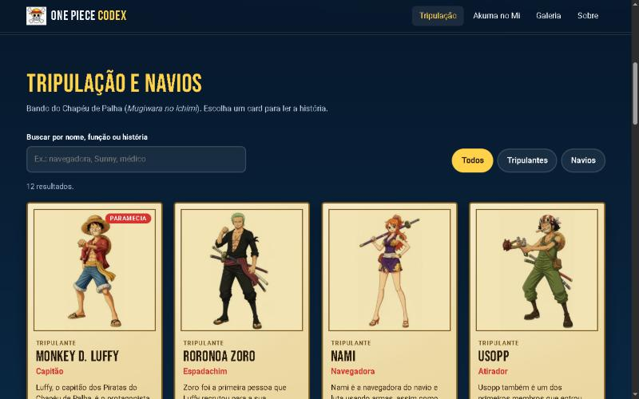

# One Piece Codex

Site de fã sobre o bando do Chapéu de Palha: a **tripulação e os navios**, as **Akuma no Mi** e uma **galeria com rolagem infinita**. Feito com HTML, CSS e JavaScript puros.

**Ver online:** https://hugohendrix.github.io/one-piece-codex/



## De onde veio

O Codex reúne em um só site três projetos de estudo que eu tinha feito separadamente e refeitos do zero:

| Projeto original | O que virou no Codex |
| --- | --- |
| [`lp-one-piece`](https://github.com/HugoHendrix/lp-one-piece), landing page | A abertura (hero), a estrutura de seções e o visual |
| [`one-piece-react`](https://github.com/HugoHendrix/one-piece-react), lista de personagens em React | Os 12 cards da tripulação e dos navios, com os textos originais |
| [`galeria-one-piece`](https://github.com/HugoHendrix/galeria-one-piece), rolagem infinita | A galeria, agora com imagens locais, botão de pausa e janela de ampliação |

## O que o site tem

- **Tripulação e navios:** 10 tripulantes e 2 navios em cards no estilo de papel de recompensa, com **busca** sem diferenciar acentos, **filtros** (todos, tripulantes, navios) e contagem de resultados.
- **Janela de detalhes** com a cena do anime, a função e a história. Navega com os botões Anterior e Próximo ou com as setas do teclado, e cada personagem tem um link direto (por exemplo, `#chopper`).
- **Akuma no Mi:** os três tipos (Paramecia, Zoan e Logia) e os quatro tripulantes que comeram uma fruta.
- **Galeria** em rolagem contínua, com pausa, ampliação da imagem e legenda.
- **Sobre o projeto** com o aviso legal de projeto de fã.

## Decisões técnicas

- **Conteúdo no HTML:** os cards, as frutas e as fotos já vêm no HTML, o que ajuda buscadores e quem não usa JavaScript. O JavaScript acrescenta busca, filtros, janelas e a rolagem.
- **Acessibilidade:** link para pular ao conteúdo, filtros com `aria-pressed`, resultado da busca anunciado (`aria-live`), janelas com `<dialog>` (foco preso e Esc nativos), foco visível e menu com `aria-expanded`.
- **Galeria acessível:** botão para pausar a rolagem, pausa ao passar o mouse ou focar, e com `prefers-reduced-motion` a animação some e a galeria vira uma faixa de rolagem manual. As cópias das fotos usadas na animação ficam com `aria-hidden`.
- **Desempenho:** as imagens passaram de **5,9 MB para 0,5 MB** ao converter para WebP, com carregamento preguiçoso e `width` e `height` definidos.
- **Imagens locais:** a galeria antiga carregava as fotos de um site externo (Pinterest). Aqui tudo fica no projeto, sem dependência de terceiros.
- **Responsivo:** testado a partir de 375 px, sem rolagem lateral.
- **SEO:** título e descrição próprios, Open Graph, Twitter Card, dados estruturados, `canonical`, `robots.txt` e `sitemap.xml`.

## Como rodar

Não há etapa de build. Abra o `index.html` no navegador ou use um servidor local:

```bash
python -m http.server 8000
```

Depois acesse http://localhost:8000.

## Estrutura

```
index.html        página única com todo o conteúdo
css/style.css     estilos
js/dados.js       dados dos personagens, navios e frutas (alimenta as janelas)
js/app.js         busca, filtros, janelas, galeria e menu
assets/           imagens em WebP, ícones e imagem de compartilhamento
docs/             captura de tela
```

Para editar um personagem, altere o card no `index.html` e o item correspondente em `js/dados.js`.

## Aviso

Projeto de fã, sem fins lucrativos e sem vínculo com os detentores dos direitos. One Piece, seus personagens e as imagens pertencem a Eiichiro Oda, à Shueisha e à Toei Animation.

## Autor

**Hugo Hendrix** · [Portfólio](https://hugohendrix.github.io/portfolio-hugo/) · [LinkedIn](https://www.linkedin.com/in/hugohendrix/) · [GitHub](https://github.com/HugoHendrix)
